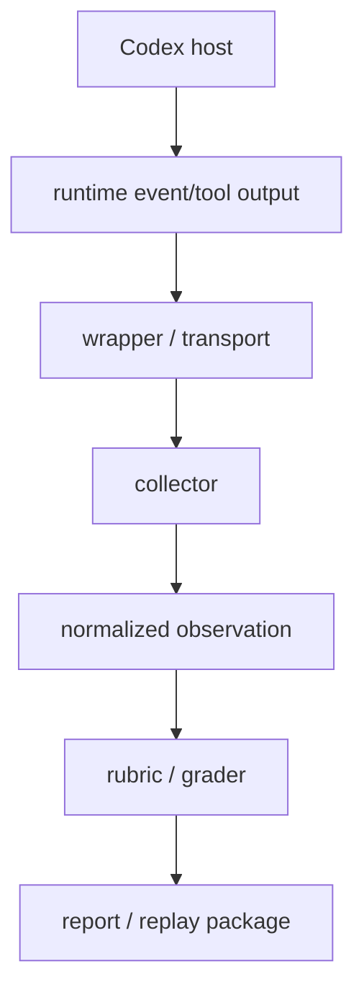

# Phase 4A 修改前根因地图

日期 2026-10-10；baseline 74ca37f5ffeb140be3ad060233282dbc4c0eb9ef。已完成只读管线研究；此图在 collector 实现修改前建立。历史 observations/results 不重评、不改写。

| Phase 3 缺口 | 原始事实与丢失层 | 根因边界 / 修复方向 |
| --- | --- | --- |
| host event/tool 不认识 | item:error、js failed 实际存在；旧 collect 只计数/忽略 started/updated，未知全局 veto | collector/normalization 丢失。新 schema 保留 safe type/category、attempt；未知影响特定证据域，缺关键证据 NOT PROVEN。 |
| reviewer 缺 verdict/role/baseline | 两 wait 存在，PLAN PASSED 只是声明；CLI collector 丢 payload | collector/report 损失已知；原 host 是否提供全部字段仍 UNKNOWN。以本机官方 schema/API 能力证明可得边界；不从 PLAN/prose regex 提升。 |
| exit -1 根因 | exit/status 存在，输出只剩 digest | normalization 过早丢非敏感 code。按结构化稳定 code 分类；没有充分 code 则 UNKNOWN。 |
| wrapper/schema 脱节 | 真实 compound PowerShell 超出刻意限定 parser；旧 grade 对 unknown 整体 FAIL | wrapper/parser/旧 rubric 独立因素。新版本用结构化工具参数与可信 executor receipts，fallback 仅 INFERRED，不扩复杂 shell parser。 |
| persistent trust drift | 四 fixture trusted blocks 精确重建前 hash；即时 installer 后 hash 未变 | fixture/host 隔离设计缺口。具体 writer 未捕获，不能声称已定位；优先官方 session/isolation 机制，真实 config zero-write guard；fallback 需精确 CAS/hash。 |
| dedicated R4 read failures | 两 read attempts exit -1，没有成功 read | host/wrapper/process 根因 UNKNOWN，不是已证实 Skill access failure。拆 A main/B standard-state/C evidence/D ordinary negative loading，用结构化 read receipts。 |
| historical STANDARD replay 缺 PLAN | grade 时真实 PLAN 存在；报告 observed.plan=undefined，scratch 清理 | report retention 缺陷；旧证据 incomplete 永久保留。新样本保留完整公开 fixture/PLAN 与原始 normalized 评分输入。 |
| path false negative | 双转义反斜线被逐字替成双 slash；同时 rg exclude/diff 文本可误记 read | normalization 缺陷。structured path 为 OBSERVED；字符串 path 仅 INFERRED，不等同成功加载。 |

另：旧 collect 对 JSON null 可实际复现 TypeError；vNext 校验事件对象形状，非对象/malformed 必须保留缺口且不 crash。

## 实现边界

采用 observation schema **2**、execution-regression **v4**、runtime rubric **3.0**；criterion unknown/reviewer/completeness 会改变 PASS 条件，所以是新的 major，不修 rubric 2.0 或 frozen v3。新的文件/fixtures/results 使用独立路径。Skill/reference/templates/prompts/installers/recovery 字节保持冻结。

事实有 provenance：OBSERVED（结构化 host/tool/FS）、DECLARED（模型/PLAN）、INFERRED（受限字符串推导）。UNKNOWN 表示缺失，不变成 FAIL/PASS。collector 不产生验收 verdict；grader 每项独立 PASS/FAIL/NOT PROVEN，unknown 只阻止受影响 criterion。未观测某 read 不证明未发生；negative assertions 要求明确完整 instrumented I/O 范围，无法证明 host 隐藏读取时保留限制。

独立只读研究：/root/p4a_pipeline；读 scripts/run-execution-regression.cjs、tests、rubric2、Phase3 runtime.cjs/results。主要位置：旧 collect 194–225、grade 270–300、report 369、cleanup 373；P3 runtime path extraction 65。官方当前宿主研究独立进行，不以历史 loss 证明 host limitation。
